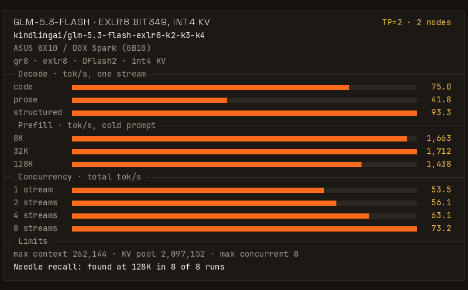
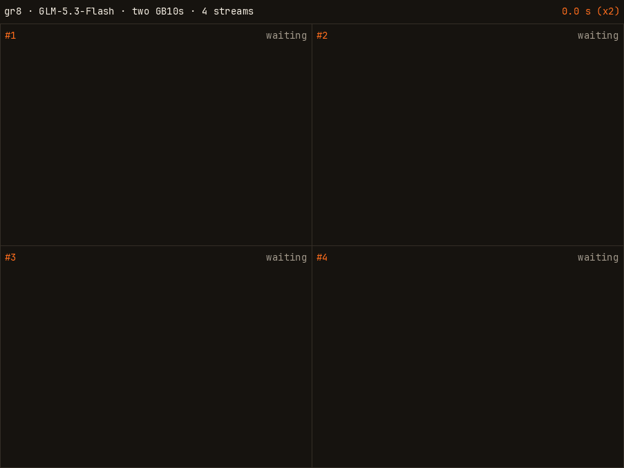

# KindlingAI: GLM-5.3-Flash EXLR8 on two DGX Sparks
**If you are an agent booting this for someone: read [AGENTS.md](AGENTS.md) first, then the Quickstart.**

_**Join our discord to learn more about KindlingAI and `gr8`: https://discord.gg/8EAvYPV2rE**_

GLM-5.3-Flash on two DGX Sparks (GB10, 128 GB each) at TP=2, served by [gr8](https://github.com/kindlingai/gr8) from
the `bit349` manifest of [kindlingai/glm-5.3-flash-exlr8-k2-k3-k4](https://huggingface.co/kindlingai/glm-5.3-flash-exlr8-k2-k3-k4)
(K3 with K4 where it lowers KL most, about 3.49 bits a routed weight): int4 KV, DFlash2 speculative decoding, eight
requests at once sharing a 2,097,152-token KV pool, and a prompt cache on disk.





*Four requests decoding at once on two GB10s, played at 2x speed.*

One box serves GLM-5.3-Flash with [glm-5.3-flash-exlr8-1x-spark](https://github.com/kindlingai/glm-5.3-flash-exlr8-1x-spark).

Pick what to prioritize with one setting, `TUNE`:

- `TUNE=speed` (the default): one request writes code at 75.0 tok/s, eight requests decode at 73.2 tok/s in total,
  and a request can be up to 262,144 tokens.
- `TUNE=context`: a request can be up to 1,048,576 tokens, with context-parallel KV. A 1,015,102-token prompt found
  its needle in 1,542 s.
- `TUNE=quality`: the release's K4 width, four requests at once, each up to 262,144 tokens.

Details: [Pick what to prioritize](#pick-what-to-prioritize), below the Quickstart.

## What you need

- Two Sparks joined by a 200G cable between their ConnectX ports (see Clustering).
- Docker and the NVIDIA container toolkit on each box (both come with DGX OS).
- No other model running on either box: the weights take about 76 GB a box (86 GB with `TUNE=quality`).
- A LAN between the two boxes, with TCP ports 7340 and 7341 open.
- Proactive memory compaction off on each box, once, as root (it holds across reboots):

  ```bash
  echo 'vm.compaction_proactiveness = 0' > /etc/sysctl.d/90-gr8-no-proactive-compaction.conf
  sysctl -w vm.compaction_proactiveness=0
  ```

## Clustering

Multiple DGX Sparks are required for this recipe. We recommend assigning one IP address per PCIe root in the DGX
Spark. The Spark's ConnectX card shows each physical port twice, once on each PCIe root. One root carries about
110 Gb/s and both together about 196 Gb/s, and the engines use both. For a cable on the first port, with netplan:

```yaml
# /etc/netplan/60-connectx.yaml on the first box. On the second box: 10.0.0.2 and 10.0.1.2.
network:
  version: 2
  ethernets:
    enp1s0f0np0:        # the first port on PCIe root 1
      addresses: [10.0.0.1/24]
      mtu: 9000
    enP2p1s0f0np0:      # the same port on PCIe root 2
      addresses: [10.0.1.1/24]
      mtu: 9000
```

Then run `sudo netplan apply` on each box.

We also recommend that you run [`mentat`](https://github.com/kindlingai/mentat) (`ghcr.io/kindlingai/mentat`) for
your cluster for zero-IP configuration. `mentat` will allow this recipe to autoconfigure itself with other nodes in
your cluster. On each box:

```bash
docker run -d --name mentat --network host --restart unless-stopped ghcr.io/kindlingai/mentat:0.27.0
```

Then start the recipe with `MENTAT=1` in place of `PEERS`, `IPS` and `IPS2`.

To run without `mentat`, specify the two nodes' 10G IP addresses using `PEERS` (head first), and the matching
ConnectX IP addresses with `IPS` (PCIe root 1) and `IPS2` (PCIe root 2), in the same order.

What to set, with and without `mentat`:

| your boxes | set | leave out |
|---|---|---|
| with `mentat` | `MENTAT=1` | `PEERS`, `IPS`, `IPS2` |
| without `mentat` | `PEERS` (head first), `IPS`, `IPS2` | |

## Quickstart

Run the published image on both boxes with the same settings. Without `mentat`, replace `<head>` and `<box2>` with the
two boxes' 10G LAN addresses, the same list on both boxes. The head is the first box in `PEERS`: it serves the API on
port 8100. `IPS` and `IPS2` are the ConnectX addresses from the netplan example above: use yours.

```bash
docker run -d --name glm53f-2x-spark --gpus all --network host --pid host --device /dev/infiniband \
  --ulimit memlock=-1 --ulimit core=0 --cap-drop ALL --cap-add IPC_LOCK \
  --security-opt no-new-privileges --read-only --tmpfs /tmp:size=1g,mode=1777 --init --oom-score-adj 1000 \
  -e PEERS=<head>,<box2> -e IPS=10.0.0.1,10.0.0.2 -e IPS2=10.0.1.1,10.0.1.2 \
  -v glm53f-2x-cache:/var/lib/gr8/cache -v glm53f-2x-prompts:/var/lib/gr8/prompts -v glm53f-2x-home:/var/lib/gr8/home \
  ghcr.io/kindlingai/glm-5.3-flash-exlr8-2x-spark:latest
docker logs -f glm53f-2x-spark     # on the head: ready at "serving: http://..."
```

With `mentat` running, replace the `PEERS`, `IPS` and `IPS2` settings with `-e MENTAT=1`: then the head is the box
with the lowest address.

The first boot downloads each box's part from Hugging Face into the `glm53f-2x-cache` volume (about 76 GB, the model
and the drafter) and converts the drafter. The boxes wait for each other, so start both within a few minutes.

The API is OpenAI's on the head's port 8100, and the model's name is `glm-5.3-flash` (`glm53f` also works):

```bash
curl -s localhost:8100/v1/chat/completions -H 'Content-Type: application/json' -d '{
  "model": "glm-5.3-flash",
  "messages": [{"role": "user", "content": "Write a haiku about a small computer."}],
  "max_tokens": 4096
}'
```

The model thinks before it answers. The thinking comes back in `message.reasoning` and counts toward `max_tokens`.

```bash
docker exec glm53f-2x-spark gr8 glm53f smoke   # on the head: 14 checks against the API
docker stop glm53f-2x-spark && docker rm glm53f-2x-spark   # on both boxes
```

The stop ends the engine's orderly quit, which gr8 #429 finishes once it has settled rather than after a fixed
wait. In the measured switch runs, stopping and removing this recipe's containers — parallel `docker compose down`
on both boxes — took 3.1-4.3 s (a two-box DGX Spark set, 2026-11-07; the runs stopped the other model's engines at
the same time, and a `docker stop` alone was not timed separately). Prompt checkpoints already written to disk
stay there ([The prompt cache](#the-prompt-cache)); the stop does not save every chat or its complete state.
`docker rm` then removes the stopped container.

`:latest` is main. Each commit is also published as `sha-<commit>`, and each tag under its name.

## Help

Ask on Discord (https://discord.gg/8EAvYPV2rE) or open an issue in this repo
(https://github.com/kindlingai/glm-5.3-flash-exlr8-2x-spark/issues). Say which step failed, and include:

- the command you ran, and the end of `docker logs glm53f-2x-spark`, before you remove the container;
- if it still runs, `docker exec glm53f-2x-spark gr8 glm53f status`.

Remove addresses and hostnames before you post.

## Run it with compose

`compose.yaml` runs the same image with the same settings and reads `PEERS` and the knobs from `.env`. On both boxes:

```bash
git clone --recurse-submodules https://github.com/kindlingai/glm-5.3-flash-exlr8-2x-spark
cd glm-5.3-flash-exlr8-2x-spark
cp .env.example .env          # set PEERS, IPS and IPS2: the same file on both boxes
docker compose up -d
docker compose logs -f
```

`docker compose up -d --build` builds the image on the box instead. CI builds every push
(`.github/workflows/image.yml`).

## Knobs

In `.env` next to `compose.yaml` (see `.env.example`), or with `docker run -e`, the same on both boxes:

| knob | default | |
|---|---|---|
| `TUNE` | `speed` | What to prioritize: `speed`, `context` or `quality` (see [Pick what to prioritize](#pick-what-to-prioritize)). It sets the defaults of `VARIANT`, `SESS`, `CAP` and `MAX_MODEL_LEN`. Any other value stops the boot. |
| `PEERS` | none | The two boxes' 10G LAN addresses, head first. Required unless `MENTAT=1`. |
| `IPS`, `IPS2` | none | Each box's ConnectX address on PCIe root 1 and root 2, in `PEERS` order (see Clustering). |
| `VARIANT` | `bit349` (`k4` with `TUNE=quality`) | The release's width manifest: `bit349`, `k4`, or another of the release's manifests (its [release card](https://huggingface.co/kindlingai/glm-5.3-flash-exlr8-k2-k3-k4/blob/1a22815d178a79f78bb44e6858f0ee446ae8f0d4/README.md) lists them). A width not in the cache yet is downloaded at boot. |
| `SESS` | `8` (`4` with `TUNE=quality`) | The requests that decode at once, 1 to 8. A request alone drafts with DFlash2. |
| `CAP` | `2097152` (`262208` with `TUNE=quality`) | The KV pool in tokens, shared by the sessions: admission reserves each request's prompt + `max_tokens` from it. Every box holds the whole pool. |
| `MAX_MODEL_LEN` | `262144` (`1048576` with `TUNE=context`) | The longest single request, prompt and output together. At most `CAP` less the guard rows, and at most 1,048,576. |
| `DFLASH` | `1` | `1`: a request alone drafts with [DFlash2](https://huggingface.co/incoai/GLM-5.3-Flash-DFlash2) (CC BY-NC-ND 4.0), downloaded and converted on the first boot. `0`: MTP only, nothing downloaded. |
| `MENTAT` | `0` | `1`: the boxes find each other and their ConnectX addresses through the host's `mentat` daemon, and register the API, in group `GROUP` (`gr8-glm53f-2x`). |

The image pins the weights to Hugging Face commits: the release at
[`1a22815`](https://huggingface.co/kindlingai/glm-5.3-flash-exlr8-k2-k3-k4/tree/1a22815d178a79f78bb44e6858f0ee446ae8f0d4)
and the drafter at [`bf582e4`](https://huggingface.co/incoai/GLM-5.3-Flash-DFlash2/tree/bf582e4eacc1810f76656d1811693ff6c6737d2a).
Set `MODEL` or `DRAFTER` in `.env` as needed (`https://huggingface.co/<org>/<repo>@<commit>`). gr8 knows `k2`, `k3` and
`k4` by name; `knobs.sh` turns another `VARIANT` name into its manifest's path in the model cache when `MODEL` names a
commit. With a `MODEL` that follows a branch, set `VARIANT` to the manifest's path.

Advanced `gr8` options can be specified in `.env` as well: [gr8/KNOBS.md](https://github.com/kindlingai/gr8/blob/48d43497f8261fc9f7a1893d1554ca4b29b35e81/KNOBS.md) lists them, and
[gr8/docs/FLASH.md](https://github.com/kindlingai/gr8/blob/48d43497f8261fc9f7a1893d1554ca4b29b35e81/docs/FLASH.md) covers GLM-5.3-Flash. The image sets `TP=2`, `KV_FORMAT=int4` and the
prompt cache (`FLASH_CACHE=aligned`, `KV_STORE=@/etc/gr8/kv-store.yaml`) (`Dockerfile`); `TUNE` sets the rest
(`knobs.sh`).

## Pick what to prioritize

`TUNE` sets `VARIANT`, `SESS`, `CAP` and `MAX_MODEL_LEN` (`knobs.sh`), and `context` also turns on context-parallel
KV. When you set one of them yourself, your value wins. Measured on two GX10s joined by one 200G cable.

| `TUNE` | sets | you get | you give up | measured |
|---|---|---|---|---|
| `speed` (default) | `VARIANT=bit349`, `SESS=8`, `CAP=2097152`, `MAX_MODEL_LEN=262144` | Decode, one stream: code / prose / structured 75.0 / 41.8 / 93.3 tok/s. Eight streams: 73.2 tok/s in total. Prefill 8K / 32K / 128K: 1,663 / 1,712 / 1,438 tok/s. 13.3-13.6 GiB free a box at idle. | Requests longer than 262,144 tokens. Some quality against K4: mean KL against BF16 0.397, K4 0.384 (the release card). | The card at the top. |
| `context` | the same as `speed`, with `MAX_MODEL_LEN=1048576` and `GR8_CP=1` in `EXTRA_ENV` | One request up to 1,048,576 tokens. Context-parallel KV keeps the first 32,768 tokens of the KV on both boxes and each later 64-token page on one box, so each box has about 1.8 GiB more free: 15.1-15.3 GiB at idle. A 1,015,102-token prompt found its needle in 1,542 s, and free memory stayed above 15.4 GiB a box. At a 156K context one stream decodes 7% faster (39.2 against 36.5 tok/s). | Decode 1-3% slower at short context. Prefill 3% / 3% / 10% slower at 8K / 32K / 128K. Eight streams 2% slower in total. T=0 output is not the same bits as with it off. gr8 marks context-parallel KV for GLM-5.3-Flash experimental. | The memory and the needle on this image. The speed differences on test builds with the same widths, `SESS` and `CAP`. |
| `quality` | `VARIANT=k4`, `SESS=4`, `CAP=262208`, `MAX_MODEL_LEN=262144` | The release's widest width, K4 (4.0 bits a routed weight, mean KL against BF16 0.384). Decode, one stream: code / prose / structured 68.8 / 40.2 / 88.0 tok/s. Prefill 8K / 32K / 128K: 1,742 / 1,625 / 1,386 tok/s. 13.2-13.4 GiB free a box at idle. | Half the sessions, an eighth of the KV pool, and about 10 GB more weights a box. Decode 4-8% slower than `speed`. Eight streams: 66.3 tok/s in total. | One run of the bench's decode, concurrency and prefill stages on this image, run as for the card. Its first boot downloaded 15 GB a box of K4 that `bit349` does not use. |

## The prompt cache

A prompt's prefill keeps a checkpoint at its last multiple of 4,096 tokens in each box's `prompts` volume
(`kv-store.yaml`, 64 GB at most). A later prompt with the same start, such as an agent's next turn, prefills only the
rest, and the output is the same bit for bit. Checkpoints outlive restarts (a new engine build, release or `CAP` starts
empty).

## How the card was made

The card at the top is one run of gr8's bench at its default level, in this image on two GX10s joined by one 200G
cable, with `TUNE=speed` and no other knob set. The run did not cool the GPUs between stages (`--hosts ''`, below).
The data is in `kindling.json`, from `python3 gr8/bench/bench.py kindling REPORT.json --out kindling.json
--config-id tp2`, and the card is `python3 gr8/bench/gif.py card kindling.json`. The GIF is the run's 4-stream
recording (`--record DIR`), drawn by `gif.py` at 2x speed. The smoke test passed 14 of 14. The 128K needle test
passed in 8 of 8 runs (`--stages correct --needle-seed N`, N from 1 to 8).

Boot, with the weights already in the cache: a restart took 30.8 s from the start command on the head to `/health`
answering 200, with the second box started first. The first boot on a new release commit took 145 s with nothing to
download: it links the unchanged files from the cached commit and checks them.

To run the bench in the image, on the head: `docker exec glm53f-2x-spark gr8 glm53f bench --hosts ''`. Without
`--hosts ''` it stops with `FileNotFoundError: 'ssh'`. The bench reaches each box over ssh to cool and sample its GPU,
and the image has no ssh. With `--hosts ''` the bench does not cool the GPUs between stages.

## Run another model

A box runs one model at a time, and gr8 does not start while another gr8 engine runs on it. To switch, stop and remove
this recipe's container on both boxes:

```bash
docker stop glm53f-2x-spark && docker rm glm53f-2x-spark   # compose: docker compose down
```

The stop ends the engine's orderly quit, as in the Quickstart, so it takes a moment before the containers go.

Switch times to and from this recipe, measured on 2026-11-07, warm, two runs each way: this recipe on a two-box
DGX Spark pair, measured on a local build of the recipe at `319ed60` with gr8 `4ed9e7b`, K4, `SESS=4` and `CAP`
262,208 (the defaults before `TUNE` set them); GLM-5.3 and DeepSeek-V4.1-Flash at TP=4 on their four-box set (two DGX Sparks, two Gen4
GB10 boxes). "Down" is the old model's stop-and-remove on every box, run in parallel (`docker compose down`),
until all have returned; "Wait after the start returns" runs from the new model's start returning until it
reports ready; "Total" runs from the start of the stop to ready.

| Switch | Down | Wait after the start returns | Total |
|---|---:|---:|---:|
| GLM-5.3 (TP=4) to this recipe | 4.9 s | 24.8 s | 31.3 s |
| This recipe to GLM-5.3 (TP=4) | 3.4-4.3 s | 69.8-70.6 s | 75.8 s (both runs) |
| DeepSeek-V4.1-Flash (TP=4) to this recipe | 3.2-4.2 s | 23.8-24.0 s | 28.5 / 29.3 s |
| This recipe to DeepSeek-V4.1-Flash (TP=4) | 3.1-3.6 s | 34.0-35.4 s | 39.7 / 40.2 s |

With compact expert copies on the GLM-5.3 side (`GR8_LOAD_COMPACT`), the switch from this recipe to GLM-5.3 took
47.2 s (both runs), against 76.2-76.3 s stock the same day (the table above is a separate session)
([gr8/docs/SWITCHING.md](https://github.com/kindlingai/gr8/blob/main/docs/SWITCHING.md#compact-expert-copies-gr8_load_compact)).

The first boot of this recipe after its files were in place took 26.5 s from the run's start to ready, of which
24.8 s came after the start command returned; the warm restart's wait also rounded to 24.8 s. The boot is loading
the K4 weights, about 86 GB, and starting the engines. (The 31.3 s row above includes stopping GLM-5.3 first.) On
the engine this recipe pinned before gr8 `4ed9e7be`, the same switch-away stop-and-remove phase took about 13-14 s.

Chats survive the round trip: four chats, their next turn replayed after a full round trip to the TP=4 model
and back, answered in 3.1-5.9 s (total response time), all four with their context intact. These test prompts
are short, and the prompt cache's checkpoints land at 4,096-token multiples, so the replays read their prompts
fresh.

Each box's part stays in its `glm53f-2x-cache` volume, so a later start of this recipe downloads nothing. To free the
disk (about 76 GB a box, more after a `TUNE=quality` boot, and up to 64 GB of prompt checkpoints), remove the volumes on both boxes:

```bash
docker volume rm glm53f-2x-cache glm53f-2x-prompts glm53f-2x-home   # compose: docker compose down -v
```

[gr8's Recipes](https://github.com/kindlingai/gr8#recipes) lists the other models and the number of boxes each one
needs.
